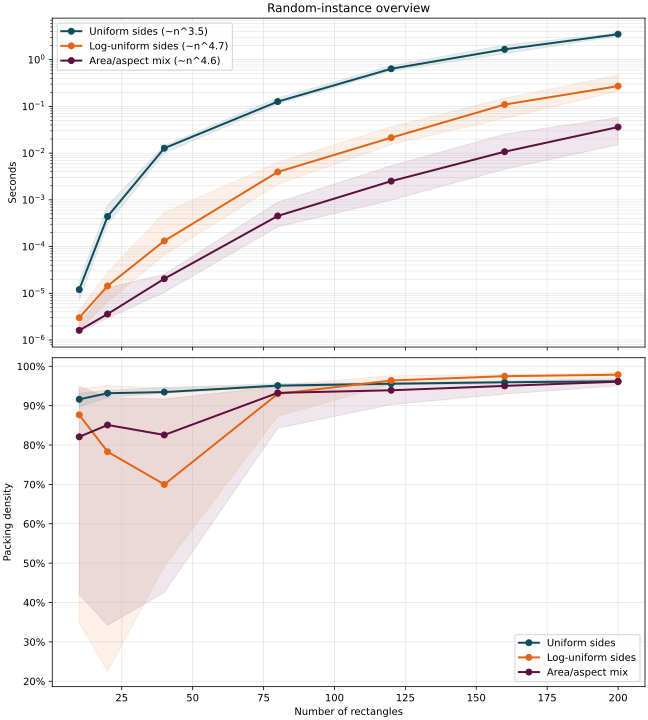
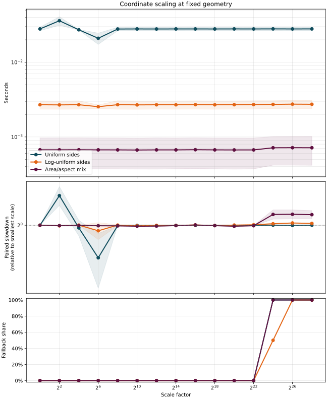
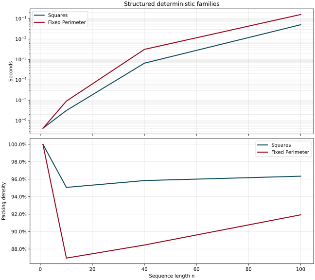
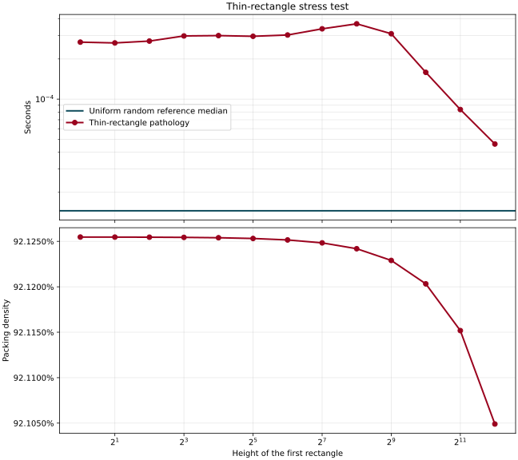

Rectangle-packer 2.1.1: detailed measurements
=============================================

These measurements use released **rectangle-packer 2.1.1**. Every measured
library source file matches tag ``2.1.1``. The downloadable manifest records
the library's content fingerprint independently of Git history. See
:doc:`benchmarks` for a short interpretation and an example for your own data.

.. list-table::
   :header-rows: 1
   :class: benchmark-table

   * - Measurement
     - Value
   * - Machine label / processor
     - machine-1 / AMD Ryzen 7 9700X 8-Core Processor
   * - System
     - Linux-x86_64
   * - Python
     - 3.13.5
   * - Mode / workers
     - latency / 1
   * - Requested CPU affinity
     - 0
   * - CPU governor
     - powersave
   * - Collection dates (UTC)
     - 2026-11-07 to 2026-11-07
   * - Measurement wall time
     - 0.15 hours
   * - Workloads / distinct exact inputs
     - 324 / 323
   * - Timing blocks / target per block
     - 7 / 50 ms
   * - Completed timed packing calls
     - 5,038,390 (warmup and calibration excluded)
   * - Deadline for an entire job
     - 600 s

One worker measured latency with the other physical cores available.
This controls intentional benchmark contention; it does not guarantee the absence
of operating-system noise or predict performance on another machine.

How to read the tables
======================

Each input contributes the median of its timed blocks. Table percentiles describe
variation between inputs, not individual calls. Brackets give a 95% percentile-bootstrap
interval for the input-population median, using 1,000 deterministic resamples.
Repeated calls and duplicate inputs are not extra independent samples.
A fixed fixture has no input-population interval. Intervals do not account for
systematic run-to-run changes in frequency, temperature, or background activity.

The random families are synthetic distributions, not a sample of user applications.
Tail estimates from small input counts, especially below 20, are uncertain.
Dimensions are integer units, and rectangles keep their orientation. Packing density
measures occupied area inside the returned bounding box, not closeness to a known optimum.

.. list-table::
   :header-rows: 1
   :class: benchmark-table

   * - Outcome
     - Jobs
   * - Valid complete packing
     - 322
   * - Expected failure on deliberately infeasible bounds
     - 2
   * - Job deadline exceeded
     - 0

Rectangle count and input shape
===============================

Uniform sides use independent dimensions in [1, 1000]. Log-uniform sides
cover that same range with more small pieces. The area/aspect mixture combines
log-uniform areas with aspect ratios between 1/16 and 16. These distributions
exercise different search costs even at equal rectangle counts.

   Median runtime and density; shading spans input p10–p90. Completed packings only; consult outcome counts for timeouts.

.. list-table::
   :header-rows: 1
   :class: benchmark-table

   * - Family
     - Rectangles
     - Inputs
     - Median [95% interval]
     - p90
     - p95
     - Median density
     - Timeouts
   * - Area aspect
     - 10
     - 8
     - 1.61 µs [1.51 µs, 1.87 µs]
     - 2.18 µs
     - 2.54 µs
     - 82.08%
     - 0
   * - Area aspect
     - 20
     - 8
     - 3.6 µs [2.94 µs, 10.7 µs]
     - 13.1 µs
     - 15.8 µs
     - 85.09%
     - 0
   * - Area aspect
     - 40
     - 8
     - 20.5 µs [10.7 µs, 24.8 µs]
     - 25.5 µs
     - 26.3 µs
     - 82.55%
     - 0
   * - Area aspect
     - 80
     - 8
     - 452 µs [286 µs, 872 µs]
     - 890 µs
     - 912 µs
     - 93.25%
     - 0
   * - Area aspect
     - 120
     - 8
     - 2.51 ms [1.32 ms, 4.06 ms]
     - 5.34 ms
     - 6.82 ms
     - 93.91%
     - 0
   * - Area aspect
     - 160
     - 8
     - 10.7 ms [5.47 ms, 20.2 ms]
     - 25.5 ms
     - 31.7 ms
     - 95.02%
     - 0
   * - Area aspect
     - 200
     - 8
     - 36.1 ms [18.6 ms, 55.7 ms]
     - 57.7 ms
     - 58 ms
     - 96.09%
     - 0
   * - Log uniform
     - 10
     - 8
     - 2.99 µs [1.77 µs, 3.8 µs]
     - 4.28 µs
     - 4.85 µs
     - 87.66%
     - 0
   * - Log uniform
     - 20
     - 8
     - 14.3 µs [7.2 µs, 18.1 µs]
     - 28.1 µs
     - 39.7 µs
     - 78.30%
     - 0
   * - Log uniform
     - 40
     - 8
     - 132 µs [82.1 µs, 419 µs]
     - 534 µs
     - 668 µs
     - 69.99%
     - 0
   * - Log uniform
     - 80
     - 8
     - 3.95 ms [2.67 ms, 5.94 ms]
     - 6.35 ms
     - 6.83 ms
     - 92.99%
     - 0
   * - Log uniform
     - 120
     - 8
     - 21.4 ms [16.3 ms, 32.2 ms]
     - 36.4 ms
     - 41.3 ms
     - 96.39%
     - 0
   * - Log uniform
     - 160
     - 8
     - 109 ms [66.5 ms, 141 ms]
     - 150 ms
     - 160 ms
     - 97.49%
     - 0
   * - Log uniform
     - 200
     - 8
     - 272 ms [211 ms, 395 ms]
     - 467 ms
     - 551 ms
     - 97.86%
     - 0
   * - Uniform
     - 10
     - 8
     - 12 µs [7.78 µs, 17.9 µs]
     - 18.1 µs
     - 18.3 µs
     - 91.61%
     - 0
   * - Uniform
     - 20
     - 8
     - 440 µs [343 µs, 559 µs]
     - 762 µs
     - 999 µs
     - 93.16%
     - 0
   * - Uniform
     - 40
     - 8
     - 12.7 ms [11 ms, 14.2 ms]
     - 14.5 ms
     - 14.9 ms
     - 93.45%
     - 0
   * - Uniform
     - 80
     - 8
     - 127 ms [114 ms, 145 ms]
     - 152 ms
     - 160 ms
     - 95.09%
     - 0
   * - Uniform
     - 120
     - 8
     - 638 ms [608 ms, 696 ms]
     - 738 ms
     - 757 ms
     - 95.58%
     - 0
   * - Uniform
     - 160
     - 8
     - 1.66 s [1.37 s, 2 s]
     - 2.06 s
     - 2.06 s
     - 95.94%
     - 0
   * - Uniform
     - 200
     - 8
     - 3.5 s [3.29 s, 3.64 s]
     - 3.7 s
     - 3.78 s
     - 96.20%
     - 0

Coordinate scaling and exact bigint reduction
=============================================

These cases multiply fixed base geometries by powers of two. Their common factors
allow exact GCD reduction after native integer bookkeeping overflows. They do not
represent general huge coprime coordinates; those appear in the scenario table below.

   Runtime, matched-input slowdown and observed fallback share. Completed packings only; consult outcome counts for timeouts.

Structured inputs and the thin-rectangle fixture
================================================

The square sequence and fixed-perimeter sequence are fixed inputs at each length.
The thin-rectangle sweep modifies one height in a known stress fixture. Repeated
timing blocks measure noise on those fixtures, not a population of geometries.

   Runtime and density of fixed structured sequences. Completed packings only; consult outcome counts for timeouts.

   Thin-rectangle stress case, compared with a random reference median. Completed packings only; consult outcome counts for timeouts.

Constraints, approximation and regression fixtures
==================================================

The approximate-bigint family uses 32 huge rectangles with coprime coordinates.
Sprite-like cases constrain either width or height to 512 units. Duplicate tiles
draw sides from 8, 16, 32 and 64 units. The exact grid is 64 identical tiles inside
a 128-by-128 bound. The two deliberately impossible families measure failure-path
latency and have no complete-packing density. Regression fixtures are small
specific inputs; they are not representative application distributions.

.. list-table::
   :header-rows: 1
   :class: benchmark-table

   * - Family
     - Rectangles
     - Inputs
     - Median [95% interval]
     - p90
     - p95
     - Median density
     - Timeouts
   * - Bigint approximate
     - 32
     - 8
     - 2.74 ms [2.18 ms, 3.23 ms]
     - 3.25 ms
     - 3.29 ms
     - 94.15%
     - 0
   * - Bounded exact grid
     - 64
     - 1
     - 16.3 µs
     - 16.3 µs
     - 16.3 µs
     - 100.00%
     - 0
   * - Bounded impossible
     - 10
     - 1
     - 531 ns
     - 531 ns
     - 531 ns
     - —
     - 0
   * - Duplicate tiles
     - 256
     - 8
     - 5.21 ms [5.15 ms, 5.26 ms]
     - 5.36 ms
     - 5.48 ms
     - 100.00%
     - 0
   * - Height limited sprites
     - 64
     - 8
     - 8.87 ms [7.32 ms, 9.36 ms]
     - 9.57 ms
     - 9.82 ms
     - 94.47%
     - 0
   * - Large height
     - 2
     - 1
     - 536 ns
     - 536 ns
     - 536 ns
     - 100.00%
     - 0
   * - One unit improvement
     - 4
     - 1
     - 887 ns
     - 887 ns
     - 887 ns
     - 55.56%
     - 0
   * - Partial impossible
     - 10
     - 1
     - 1.34 µs
     - 1.34 µs
     - 1.34 µs
     - —
     - 0
   * - Width limited sprites
     - 64
     - 8
     - 17.5 ms [14.6 ms, 23.7 ms]
     - 25.9 ms
     - 28.5 ms
     - 93.66%
     - 0

.. list-table::
   :header-rows: 1
   :class: benchmark-table

   * - Observed warmup route
     - Completed jobs
   * - approximate
     - 8
   * - exact_gcd
     - 17
   * - native
     - 299

Evidence and reuse
==================

All displayed values are generated from the verified campaign. The corpus stores
the exact rectangles, bounds and expected outcomes; the raw records preserve every
timing block and repeat count. Reuse this corpus to evaluate another implementation
without relying on the current random generator.

* :download:`Machine, source and build manifest <_static/benchmark-data/2.1.1/manifest.json>`
* :download:`Full numeric summary <_static/benchmark-data/2.1.1/summary.json>`
* :download:`Compressed raw measurements <_static/benchmark-data/2.1.1/results.jsonl.gz>`
* :download:`Exact input corpus <_static/benchmark-data/2.1.1/corpus.jsonl.gz>`
* :download:`Measured source snapshot <_static/benchmark-data/2.1.1/source.tar.gz>`
* :download:`Native compiler log <_static/benchmark-data/2.1.1/build.log>`
* :download:`Figure and summary bindings <_static/benchmark-data/2.1.1/plot_manifest.json>`
* :download:`Plot and report source snapshot <_static/benchmark-data/2.1.1/plot-source.tar.gz>`

Corpus fingerprint: ``85521a70d71fad99adc7f3e968c305a7c0cf30eb07b873e83856d59da8828dff``.

Native extension fingerprint: ``ed879d2fb10cfb49c6473b437375bd045c1ded4a18a9fe01eceb841c7e893853``.
