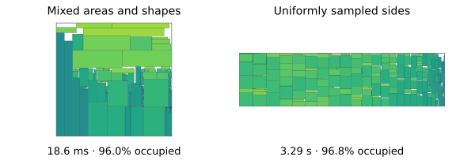
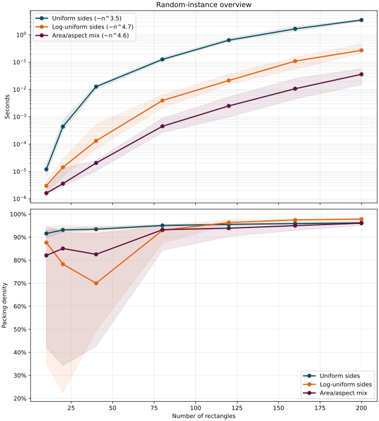

===========================
Performance and limitations
===========================

How fast is rectangle-packer?
=============================

With **200 rectangles**, the mixed-area and uniform-side samples both filled
about **96%** of their bounding boxes. Median packing time was **36 ms** for
the mixed-area inputs and **3.50 s** for the uniformly sampled sides. These
are warm calls to rectangle-packer 2.1.1 on an AMD Ryzen 7 9700X.

   Each diagram shows one measured input (instance 7) at its own scale.
   White gaps are unused space. The times beneath the diagrams are medians
   for those individual inputs.

Representative results
======================

Each row summarizes eight distinct inputs. We took the median of seven timed
blocks for each input, then the median across the eight inputs. Density is
the fraction of the returned bounding box covered by rectangles.

Uniform sides sample widths and heights evenly from 1 to 1,000. Log-uniform
sides favor smaller dimensions over that same range. The area/aspect mixture
samples rectangle areas and aspect ratios.

.. list-table::
   :header-rows: 1
   :class: benchmark-table

   * - Input family
     - Rectangles
     - Median latency
     - Median density
   * - Area/aspect mixture
     - 40
     - 20.5 µs
     - 82.6%
   * - Log-uniform sides
     - 40
     - 132 µs
     - 70.0%
   * - Uniform sides
     - 40
     - 12.7 ms
     - 93.5%
   * - Area/aspect mixture
     - 200
     - 36.1 ms
     - 96.1%
   * - Log-uniform sides
     - 200
     - 272 ms
     - 97.9%
   * - Uniform sides
     - 200
     - 3.5 s
     - 96.2%

Try your own rectangle sizes
============================

With rectangle-packer installed, save a non-empty JSON list of positive integer
``[width, height]`` pairs as ``sizes.json``. Run this in Python using the version
you intend to deploy::

   import json
   import statistics
   import time
   import rpack

   with open("sizes.json") as stream:
       sizes = [tuple(size) for size in json.load(stream)]
   rpack.pack(sizes)  # Warm up before measuring.
   times = []
   for _ in range(7):
       start = time.perf_counter()
       positions = rpack.pack(sizes)
       times.append(time.perf_counter() - start)
   density = rpack.packing_density(sizes, positions)
   print("Version:", rpack.__version__)
   print("Median call:", statistics.median(times), "seconds")
   print("Occupied area:", format(density, ".1%"))

Use representative application inputs and any width or height limits your
application requires in both packing calls. This quick check reports repeated
call timing for one input; it is not a distribution across different inputs.
For very fast calls or controlled comparisons, use the calibrated benchmark
runner described in :doc:`benchmark-methodology`.

How performance varies
======================

   Released-version measurements across the sampled rectangle counts. Fitted
   curves describe these observations; do not extrapolate them into complexity
   claims or runtime guarantees.

What to watch for
=================

* Similar rectangle counts can have very different costs. In this sample,
  256 duplicate-sized tiles took 5.21 ms at the median with 100% median density,
  while 200 uniformly sampled rectangles took 3.50 s.
* Packing quality depends on shape and constraints. Very large coordinates
  may require approximation; inspect the resulting density on your own data.
* The sample is small: eight inputs per random family and count. It cannot
  establish production tail latency, worst-case runtime or failure probability.
* These are repeated warm calls on one machine. Memory use, startup time,
  concurrent application performance and competing packages were not measured.

Details and reproducibility
===========================

The supporting dataset has 324 measured workloads, including structured and
constrained cases. All 322 expected successes produced valid geometry; the
two deliberately impossible inputs failed as expected. There were no timeouts.

The detailed report includes the inputs and raw measurements. The methodology
explains how to reproduce the run and compare releases.

.. toctree::
   :maxdepth: 1

   benchmark-details
   benchmark-methodology
